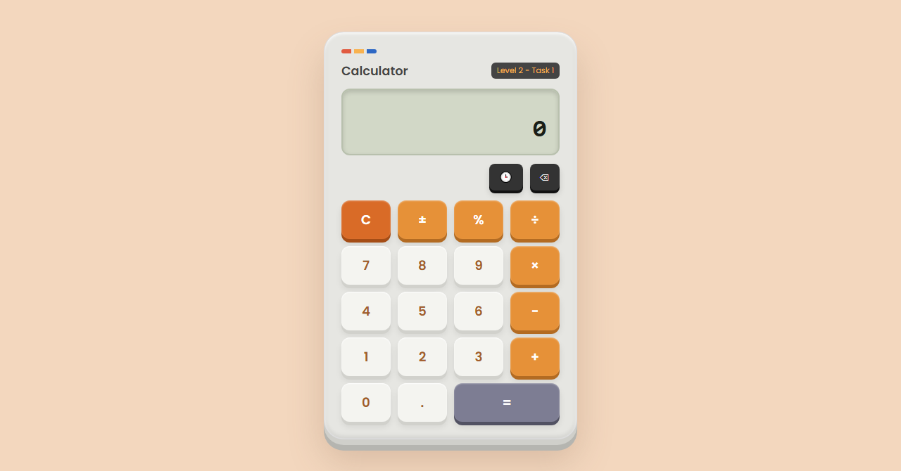
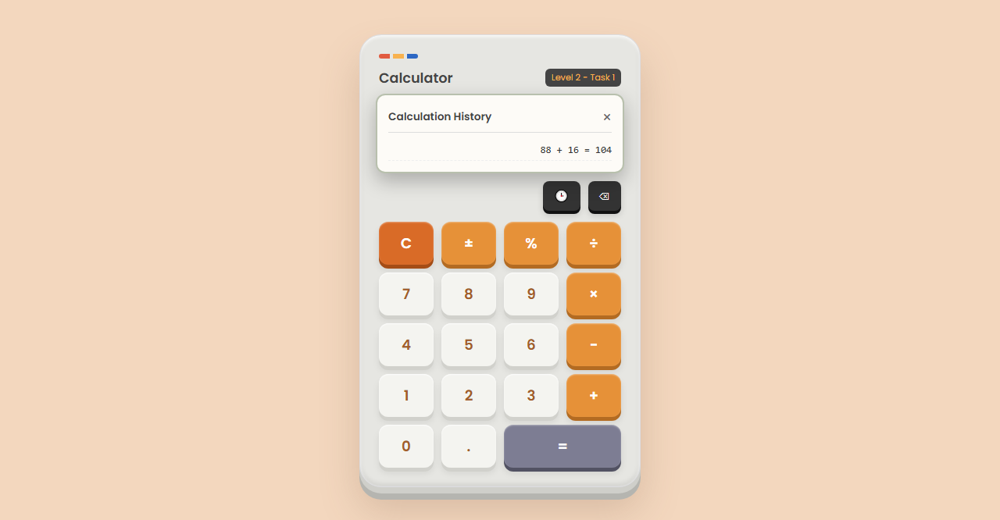

# Calculator – Level 2, Task 1

**Intern:** L V Gireesh | **Track:** Web Development & Designing | **Oasis Infobyte SIP**

A browser-based calculator built with HTML, CSS and vanilla JavaScript. The keypad uses CSS Grid, all buttons are wired with event listeners, and no `eval()` is used. The calculation logic is written by hand in a `Calculator` class.

## Screenshots

## Features

- Display showing the current input and the pending operation
- Number buttons 0–9 and a decimal point (a second decimal point is ignored)
- Operators: addition, subtraction, multiplication (×) and division (÷)
- Equals button to evaluate
- **C** to clear and **⌫** to delete the last character
- **Division by zero** shows `Error` instead of crashing, and the next key press recovers
- **Operator chaining**: press another operator and the result so far is computed first
- Extras: sign toggle (±), percent/modulo (%), and a history panel of the last 10 calculations
- Results are rounded to 7 decimal places to avoid floating-point noise such as `0.1 + 0.2`
- Keypad laid out with **CSS Grid**
- All buttons use `addEventListener`, with no inline `onclick` attributes

## How chaining works

Operations are evaluated left to right as you press operators, like a basic pocket calculator. For example, `5 + 3 × 2` gives `16` (that is, `(5 + 3) × 2`) and does not apply operator precedence.

## Run it

Open `index.html` in any modern browser. No build step or dependencies are needed.

## Files

| File | Purpose |
|------|---------|
| `index.html` | Structure and keypad markup |
| `style.css` | Layout (CSS Grid), theme and responsive styling |
| `script.js` | `Calculator` class and event listeners |

## What I learned

Managing application state in a class, handling edge cases (division by zero, repeated decimals, chained operators) and building a responsive grid layout.
