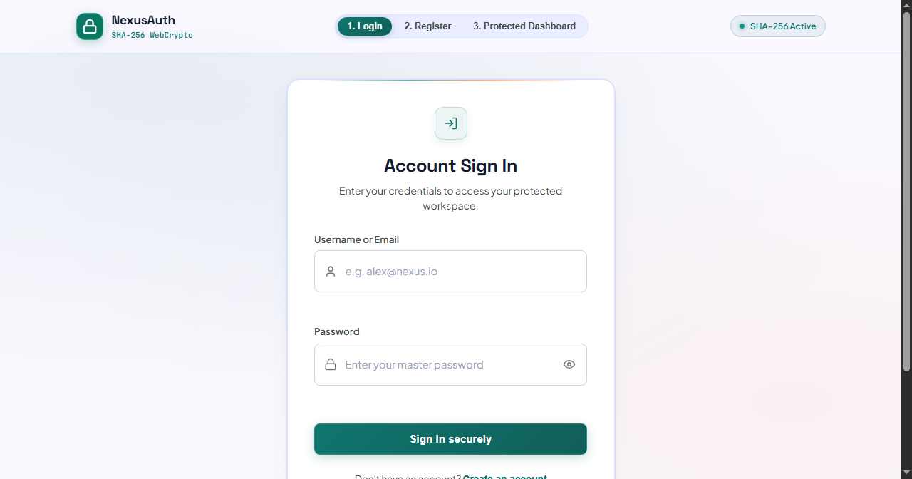
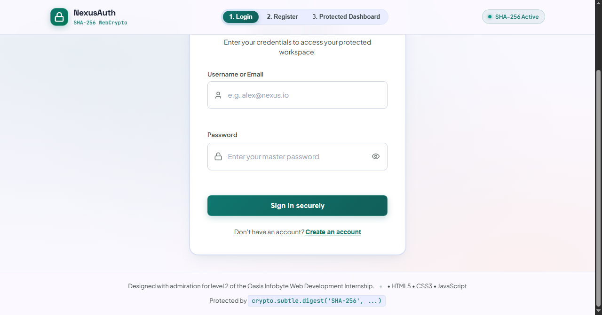
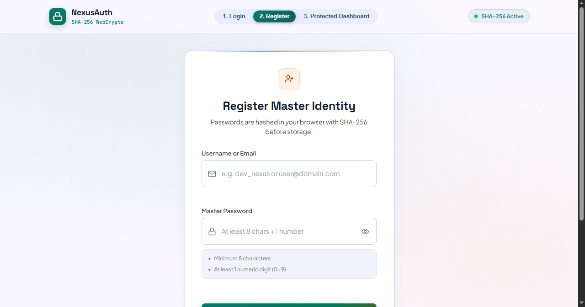
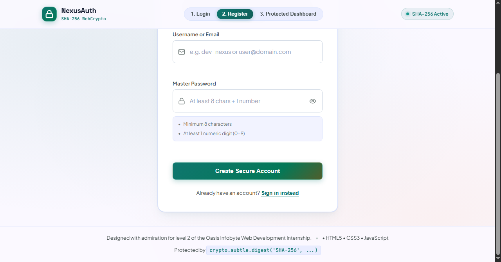
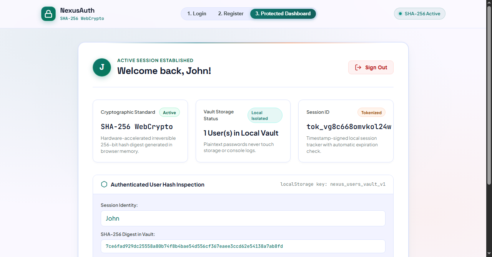
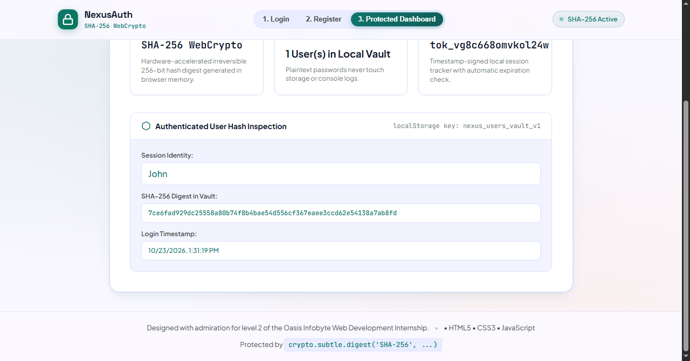

# Login Authentication System – Level 2, Task 4

**Intern:** L V Gireesh | **Track:** Web Development & Designing | **Oasis Infobyte SIP**

A front-end authentication system with registration, login, a protected dashboard and logout. It uses **Approach A** from the task brief (HTML, CSS and JavaScript with `localStorage`), and the Web Crypto API for password hashing.

## Screenshots

## Features

- **Registration** with username or email and password
- **Password rules** enforced with live feedback: at least 8 characters and at least 1 number
- **Duplicate check**: registering an existing username or email shows an error
- **Login** with a generic error message ("Invalid username or password.") that does not reveal which field was wrong
- **Protected dashboard**: opening it without a session sends you back to the login screen
- **Logout** clears the session and returns to login
- **Hashed passwords**: passwords are never stored in plain text; they are hashed with SHA-256 using `crypto.subtle.digest`
- Form validation on both screens, so empty submissions are rejected
- Toast notifications for success and error states

## How it works

1. On registration the password is hashed in the browser and only the hash is saved in `localStorage`.
2. On login the entered password is hashed and compared with the stored hash.
3. A successful login creates a session record in `localStorage`. The dashboard checks for it before rendering.
4. Logout removes the session.

## Security note

This is a learning project. Because everything runs in the browser, the stored data is visible to anyone using that browser, and the SHA-256 hash is unsalted. A real application should authenticate on a server with a salted, slow hash such as bcrypt or Argon2, and use secure server-side sessions.

## Run it

Open `index.html` in any modern browser. If hashing does not work when opened as a file, serve the folder locally (for example with VS Code *Live Server*), because the Web Crypto API needs a secure context.

## Files

| File | Purpose |
|------|---------|
| `index.html` | Login, register and dashboard views |
| `style.css` | Styling and responsive layout |
| `script.js` | Hashing, validation, session handling and view switching |

## What I learned

How authentication flows work end to end, hashing with the Web Crypto API, session guarding, and why client-side security has limits.
