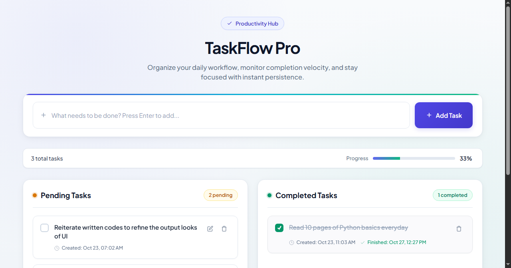
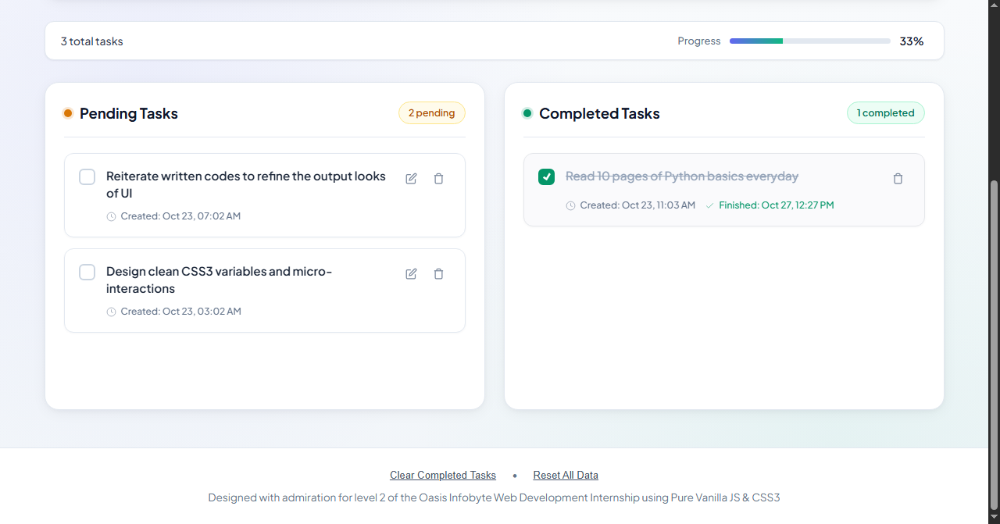

# To-Do Web App (TaskFlow Pro) – Level 2, Task 3

**Intern:** L V Gireesh | **Track:** Web Development & Designing | **Oasis Infobyte SIP**

An interactive task manager that organises work into **Pending** and **Completed** lists. It is built with HTML, CSS and vanilla JavaScript, and tasks are saved in the browser, so they survive a page refresh.

## Screenshots

## Features

- Input field and **Add Task** button (pressing Enter also adds)
- New tasks appear instantly in the Pending list
- **Mark complete** toggle moves a task between Pending and Completed
- **Edit** a task inline (Enter to save)
- **Delete** a task permanently from either list
- Live counters: "X pending" and "Y completed"
- Progress bar showing the percentage of tasks completed
- **Timestamps** showing when each task was added and completed *(bonus)*
- **localStorage persistence** across refreshes *(bonus)*
- Friendly **empty-state messages** when a list has no items
- Extras: "Clear completed" and "Reset all" actions, plus small animations on complete and delete

## Notes

- On first load the app shows two sample tasks. Delete them or use **Reset all** to start fresh.
- Data is stored only in your browser's localStorage, so clearing site data removes your tasks.

## Run it

Open `index.html` in any modern browser.

## Files

| File | Purpose |
|------|---------|
| `index.html` | Layout, form and list containers |
| `style.css` | Theme, cards, progress bar and responsive styles |
| `script.js` | State, rendering, add/edit/complete/delete logic and persistence |

## What I learned

Rendering UI from a single source of truth (the tasks array), DOM manipulation, saving state with `localStorage`, and handling edge cases such as empty lists.
