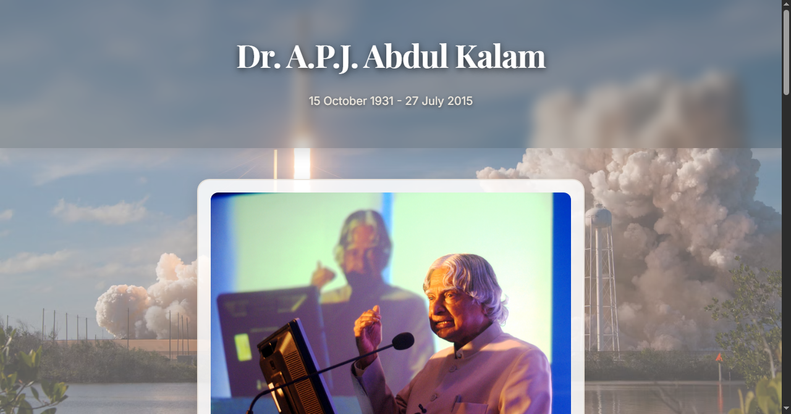
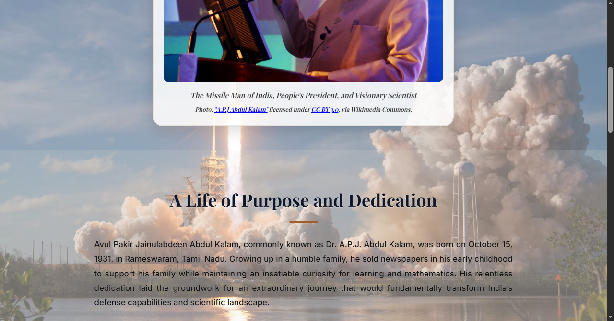
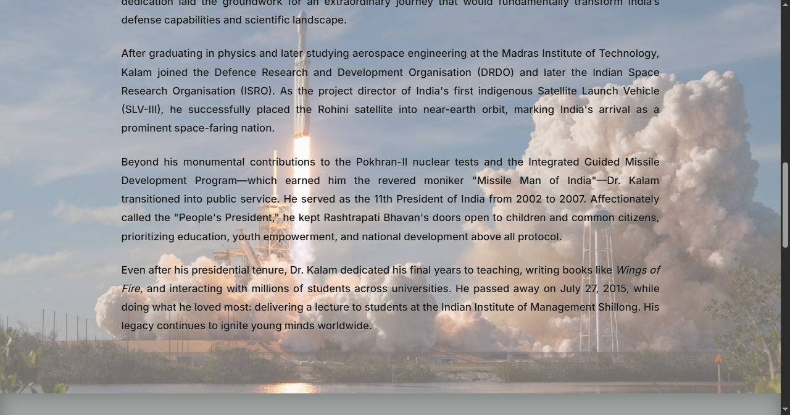
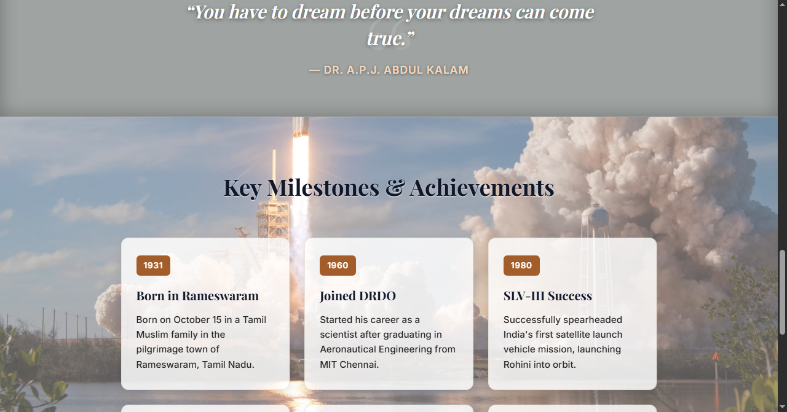
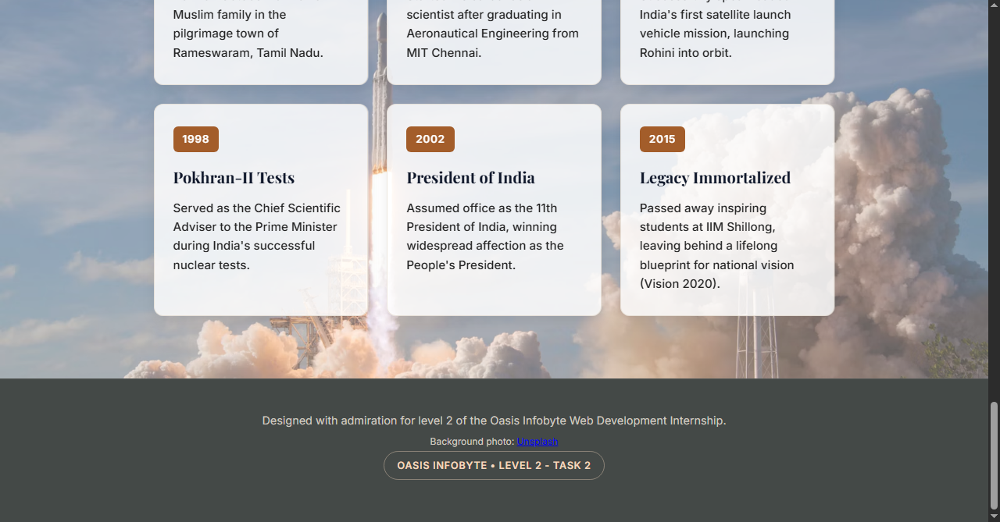

# Tribute Page – Level 2, Task 2

**Intern:** L V Gireesh | **Track:** Web Development & Designing | **Oasis Infobyte SIP**

A responsive tribute page dedicated to **Dr. A.P.J. Abdul Kalam**, the "Missile Man of India" and 11th President of India. It is built with HTML5 and CSS3 only.

## Screenshots

## Features

- Page title with the subject's name, life dates and a one-line tagline
- Prominent portrait image in the header, with attribution in the caption
- Biography section of four original paragraphs
- Distinctly styled **quote block**
- **Timeline** of six milestones (1931 to 2015) in a card grid
- Multiple background treatments across sections (full-page image, translucent header, cream and tinted cards)
- Two font families: **Playfair Display** (serif, headings) and **Inter** (sans-serif, body)
- Responsive layout with a media query for tablet and mobile widths

## Content and sources

The biography is written in my own words from publicly available information about Dr. Kalam's life and career.

## Image credits

- **Portrait:** ["A.P.J Abdul Kalam"](https://commons.wikimedia.org/wiki/File:A.P.J_Abdul_Kalam.jpg), licensed under [CC BY 3.0](https://creativecommons.org/licenses/by/3.0/), via Wikimedia Commons. The image is loaded directly from Wikimedia Commons and is not modified.
- **Background photo:** [Unsplash photo](https://images.unsplash.com/photo-1517976487492-5750f3195933?auto=format&fit=crop&w=1600&q=80), used under the [Unsplash License](https://unsplash.com/license).

## Run it

Open `index.html` in any modern browser. An internet connection is needed for the Google Fonts, the portrait (Wikimedia Commons) and the Unsplash background.

## Files

| File | Purpose |
|------|---------|
| `index.html` | Page structure and content |
| `style.css` | Design tokens, layout, timeline and responsive rules |

## What I learned

Building a design system with CSS custom properties, pairing serif and sans-serif typography, crediting openly licensed images correctly, and structuring long-form content so it stays readable on small screens.
